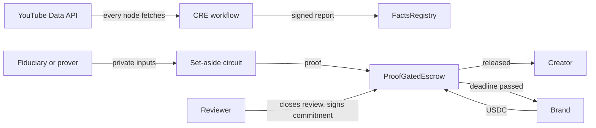

# Architecture

## Rule engine: `src/rules/index.ts`

Exact integer arithmetic, in cents and basis points. Each result carries its citation and rule version.

| Rule | Minnesota | California |
|---|---|---|
| Coverage | At least 30% of paid content | At least 30%, and at least $1,250 for the period |
| Set-aside | Half the content percentage | 65% of the content percentage |
| Under 14 | Barred, 100% owed, flagged | No special rule |
| Siblings | Equal split | Same split, flagged as unconfirmed |

## Circuit: `circuits/setaside.circom`

The circuit proves that a deposit covers the amount owed. Private inputs are earnings, content share, number of minors, age, deposit and a salt. Public inputs are the commitment, deal, period and jurisdiction, so a proof can't be replayed on another deal, period or statute. Floor division uses witness quotients. Every value used in a product is range checked, because an unbounded quotient could wrap the field and understate what is owed.

A shortfall has no valid witness, so it can't produce a proof at all. `test/differential.test.ts` confirms the circuit and rule engine agree on the exact cent.

## Escrow: `contracts/ProofGatedEscrow.sol`

A brand opens a deal under a compliance clause in the sponsorship contract. This is a contractual gate, not a statutory one. The named reviewer closes a period by signing off a commitment. `release` then verifies a proof against that commitment and pays the creator. If no valid proof arrives by the deadline, the brand can reclaim the funds.

Wallets, amounts and timing are public on this rail, so it isn't a private payment. Fiat payments bypass it entirely. Whether holding USDC this way counts as escrow, or falls under California's Digital Financial Assets Law, is an open legal question.

## Workflow: `workflow/`

On a schedule, every node requests the same videos from the YouTube Data API. Only stable fields are requested, because identical consensus fails on volatile ones such as view counts. The nodes agree on a digest of the facts and a count of contradictions, then write a report to `FactsRegistry`.

A contradiction is a video declared as zero participation whose public title or description names the child. Statutes count name and oral narrative as well as likeness, though a title match alone is arguable as evidence. Stored digests also reveal edits made after capture.

The channel is stored as a hash, and the stage name stays in the secrets store.

## Privacy

No child's name, age or income appears on-chain. The commitment hides its inputs behind a random salt. Payment amounts in the escrow are still visible, as noted above.
