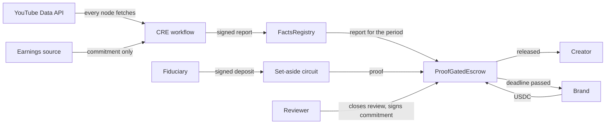

# Architecture

## Rule engine: `src/rules/index.ts`

Exact integer arithmetic, in cents and basis points. Each result carries its citation and rule version.

| Rule | Minnesota | California | Illinois |
|---|---|---|---|
| Coverage | 30% of paid content and view test | 30%, view test, and at least $1,250 in the month | 30% and view test, minors under 16 |
| Set-aside | Half the content percentage | 65% of the content percentage | Half the content percentage |
| Under 14 | Barred, 100% owed, flagged | No special rule | No special rule |
| Siblings in a segment | Equal split | Equal split | Equal split |

## Circuit: `circuits/setaside.circom`

The circuit proves that a deposit covers the amount owed, that the deal's fiduciary signed that deposit for this deal and period, and that the earnings open the commitment in the oracle report. Private inputs are earnings, content share, number of minors, age, the view test, the deposit, a salt and the signature. Public inputs are the commitment, deal, period, jurisdiction, fiduciary public key, earnings commitment and facts digest, so a proof can't be replayed on another deal, period or statute, and a parent can't claim a figure the fiduciary didn't sign. Floor division uses witness quotients. Every value used in a product is range checked, because an unbounded quotient could wrap the field and understate what is owed.

A shortfall has no valid witness, so it can't produce a proof at all. `test/differential.test.ts` confirms the circuit and rule engine agree on the exact cent across sampled boundary cases.

Content share is still declared by the parent, which is why release also needs a human review.

## Review: `src/review.ts`

Videos for review are picked from public randomness, published after declarations are sealed, with half the sample taken from around the 30% line. Results give an under-declaration rate with a Wilson 95% interval, and flag any video that a review moves across the line.

## Escrow: `contracts/ProofGatedEscrow.sol`

A brand opens a deal under a compliance clause in the sponsorship contract. This is a contractual gate, not a statutory one. The named reviewer closes a period by signing off a commitment. `release` then reads the oracle report for the period, reverts if there is none or if it reports a contradiction, and verifies a proof against the report and the commitment before paying the creator. If no valid proof arrives by the deadline, the brand can reclaim the funds.

Wallets, amounts and timing are public on this rail, so it isn't a private payment. Fiat payments bypass it entirely. Whether holding USDC this way counts as escrow, or falls under California's Digital Financial Assets Law, is an open legal question.

## Workflow: `workflow/`

On a schedule, every node requests the same videos from the YouTube Data API. Only stable fields are requested, because identical consensus fails on volatile ones such as view counts. Nodes also read an earnings commitment from the earnings source, which holds the figure itself, so nodes never see the income. They agree on the digest, the commitment and a count of contradictions, then write a report to `FactsRegistry` for that deal and period. Handler logic is in `handler.ts`, and `handler.test.ts` runs it under the SDK test runtime.

A contradiction is a video declared as zero participation whose public title or description names the child. Statutes count name and oral narrative as well as likeness, though a title match alone is arguable as evidence. Stored digests also reveal edits made after capture.

The channel is stored as a hash, and the stage name stays in the secrets store.

## Privacy

No child's name, age or income appears on-chain. The commitment hides its inputs behind a random salt. Payment amounts in the escrow are still visible, as noted above.
